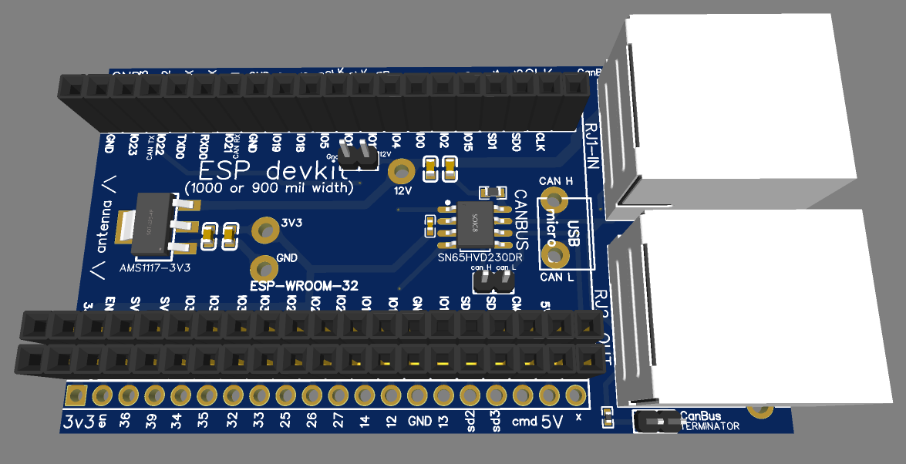
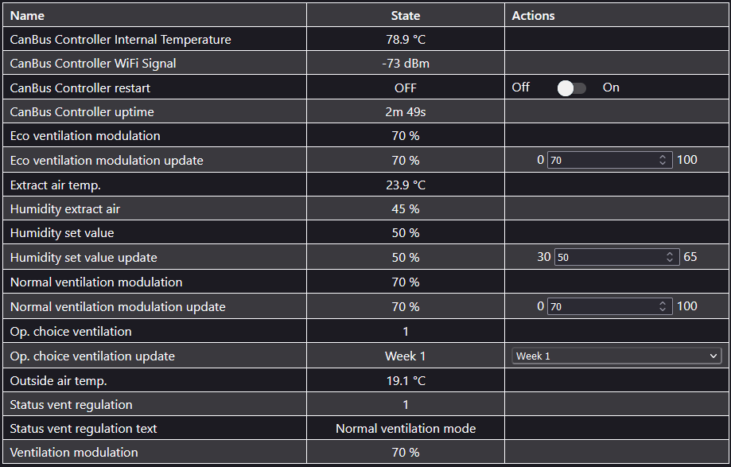
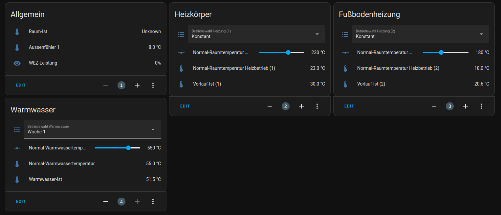

# An ESP32 CanBus shield - made for hoval homevent, but for all canbus applications

<!---[](https://github.com/nliaudat/esp_canbus/wiki)
[](https://github.com/nliaudat/esp_canbus/actions?query=workflow%3ABuild+branch%3Amain)-->

> **⚠️ New core version — major refactor**
>
> This is a major refactor of the firmware, targeting a future submission to the
> official ESPHome components. The original firmware remains available on the
> [`legacy`](https://github.com/nliaudat/esp_canbus/tree/legacy) branch.
>
> Key changes:
>
> - **The `next` branch builds the component from
>   [ESPHome PR #20900](https://github.com/esphome/esphome/pull/20900)** through
>   `external_components`. The copy in `esphome/components/toptronic/` is not used
>   by `config.yaml`.
> - **Presets ship with the component**, in four languages (`de`/`en`/`fr`/`it`).
> - **`config.yaml` changed** — you can now define **multiple `toptronic:` components**
>   (one per CAN device - presets for `WEZ`, `SOL`, `PS`, `FW`, `HK`, `MWA`, `GLT`, `HV`, `BM` and `GW`).
> - Fixed-slot multi-frame reassembly with CRC validation, automatic pause during
>   OTA updates and a throttled post-boot refresh.

**Migrating from `legacy`?** Device addressing moved from each entity to the hub,
entities are now auto-generated from the presets, and the config is multi-hub.
See the [component reference](esphome/readme.md) for details. Protocol
documentation, CRC reverse-engineering notes, and review references live in
the [`docs`](docs/) folder; parts of it still describe the local component rather
than the PR version.




    
## Functionalities : 
* Compatible with 1000 or 900 mil width ESP devkit
* Full headers for extending or debug
* The card use a ESP32-WROOM-32D as logics and wifi connection. (You can get a 32U if you want an external antenna)
* The software runs under esphome to be easy to customize and linked with https://www.home-assistant.io 
* Power is taken from CanBus 12V and converted to 3.3v with AMS1117-3.3V (not needed but recommended, if cutting the "3v3V cutout", you can use external power supply)
* SN65HVD230 3.3-V CAN Bus Transceivers

## Fabrication : 

* PCB can be ordered with chips assembled at JLPCB for 50$ for 5 boards.
* ESP32-WROOM-32D costs approx 3.8$
* Box is 3D printed or fit in a 86x86 electrical box

## Firmware

<p align="center">
    
    <!--  -->
    <br />
    <i>web interface at http://canbus.local/</i>
</p>

### Features

* Powered by [ESPHome](https://esphome.io/)
* Webserver enabled at [canbus.local](http://canbus.local/)
* Automatically recognized by [Home Assistant](https://www.home-assistant.io/)

### Installation

#### Requirements

Make sure you have Python and ESPHome installed. <br />
To install ESPHome you can follow the [manual installation guide](https://esphome.io/guides/installing_esphome) or use [Docker](https://esphome.io/guides/getting_started_command_line#installation).

The PR currently needs an ESPHome **development** version dated 2026-10-24 or later
(it relies on [ESPHome PR #21592](https://github.com/esphome/esphome/pull/21592)).

You can validate your installation by running

```bash
> esphome version
Version: 2026.12.0-dev
```

#### Firmware configuration

Before flashing, the following files need to be customized for **your**
installation. All of them live in the `esphome/` folder.

##### 1. `esphome/secrets.yaml` — REQUIRED (create it)

This file is **gitignored** — it is never committed. Create it in
`esphome/secrets.yaml` with your WiFi credentials:

```yaml
wifi_ssid_1: "your_main_wifi"
wifi_password_1: "your_main_password"
wifi_ssid_2: "your_second_wifi"
wifi_password_2: "your_second_password"
wifi_ssid_3: "your_third_wifi"
wifi_password_3: "your_third_password"
fallback_hotspot_password: "your_fallback_ap_password"
```

> If you have fewer networks, leave the unused entries — ESPHome only uses the
> networks that are actually listed in `packages/wifi.yaml`.

##### 2. `esphome/config.yaml` — REQUIRED

Open `config.yaml` and adjust:

- `substitutions:`
  - `name` — used as the device name / mDNS hostname (`canbus` → `http://canbus.local/`)
  - `friendly_name` — shown in Home Assistant
  - `can_tx_pin` / `can_rx_pin` — your CAN transceiver wiring (defaults `GPIO22`/`GPIO21`)
  - `board_type` — your ESP32 devkit (default `az-delivery-devkit-v4`)
  - `TZ` — your timezone (default `Europe/Zurich`)
- `toptronic:` — one block **per device** (device type + address). You can find the
  address of each Hoval device in your room control unit under maintenance
  (e.g. `HV(8)`, `BM(8)`, `WEZ(1)`). Presets for all supported device types ship with
  the component in [PR #20900](https://github.com/esphome/esphome/pull/20900).

Example exposing both an HV and a BM device:

```yaml
substitutions:
  name: canbus
  # ...

toptronic:
  - id: toptronic_HV  # HomeVent
    canbus_id: cbus  # the canbus bit_rate must be 50kbps. do not change name as it used in canbus.yaml
    device_type: HV  # WEZ, SOL, PS, FW, HK, MWA, GLT, HV, BM, GW (BD is an alias for BM and BM must be used)
    device_addr: 8  # defaults are : HV=8, BM=8, WEZ=1
    language: en  # de, en, fr, it
    # boot_refresh_delay: 30s  # optional; one-shot full refresh after boot; 0s disables it
    # max_pending_messages: 2  # optional; concurrent multi-frame reassemblies per hub (1..16)
    # max_pending_age: 5000ms  # optional; a pending message this old with no continuation is lost
    # max_frames_per_message: 8  # optional; max total frames a start frame may claim (3..31)
    # refresh_interval: 50ms  # optional; spacing between two refresh GETs (min 16ms)
    # max_refresh_retries: 1  # optional; re-sends of an unanswered GET per refresh burst (0..10)
    # refresh_retry_interval: 200ms  # optional; delay before an unanswered GET is re-sent
    # write_min_interval: 2s  # optional; min time between two writes to the same datapoint (0s = off)
    # reject_writes_before_read: true  # optional; refuse writes to datapoints not read since boot

  - id: toptronic_BM  # display
    canbus_id: cbus
    device_type: BM
    device_addr: 8
    language: en
```

The commented options are optional, shown with their defaults, and can be set on
each hub. See the [component reference](esphome/readme.md#hub-configuration) for
the full description of each.

With more than one hub, every preset entity name is prefixed with the device type
and address (`HV 8: Outside air temp.`). A single hub keeps the bare names.

##### 3. `esphome/packages/wifi.yaml` — usually REQUIRED

This package contains the WiFi networks referenced by `secrets.yaml`. Add /
remove network entries to match your environment, and uncomment `hidden: true`
for hidden SSIDs. The fallback hotspot SSID is derived from `name`
(`<name> Fallback`, e.g. `canbus Fallback`) and uses
`fallback_hotspot_password` from `secrets.yaml`.

##### 4. `esphome/packages/board.yaml` — OPTIONAL

- `esp32.board` comes from the `board_type` substitution in `config.yaml`
  (e.g. `az-delivery-devkit-v4`, `nodemcu-32s`, `esp-wrover-kit`) — change it there,
  not here.
- The `api:`, `ota:`, and `safe_mode:` blocks are usually left at their defaults.
- No OTA lambdas are needed: the component pauses its CAN traffic during an update
  and resumes it afterwards.

##### 5. Other packages — usually leave as-is

`time.yaml` (SNTP + optional weekly reboot), `sensors_others.yaml` (WiFi signal /
internal temperature), `switch.yaml` (restart + candump/find_can_id debug
toggles), and `canbus.yaml` (50 kbps `esp32_can` platform). `debug.yaml` is
**opt-in** — it adds a button that sends a raw GET request, for testing, and must be
enabled manually in `config.yaml`. The "Refresh all" button is auto-generated by the
`toptronic` component — there is no `button.yaml` anymore.

> ℹ️ Candump and "find can_id" bus debugging are available at runtime as two
> switches (see `esphome/packages/switch.yaml`): **"candump debug"** logs CAN
> frames, including the gateway's own GET/SET requests (received frames are rate
> limited and the skipped ones counted), and **"find can_id debug"** logs the sender
> of received single-frame 0x40/0x42 messages as warnings, which also show in the
> "main logs" text sensor. Both turn off after two minutes and are off after a
> reboot. The old commented-out `on_frame` blocks in `canbus.yaml` are kept for
> reference only.

If you want to create your own preset or need other datapoints, have a look at
[`hoval_data_processing`](hoval_data_processing/).

#### Flash the firmware

Connect your ESP32 via USB to your computer. (Only required for the first time, subsequent installations can be done over WiFi) <br />
Then run `esphome run config.yaml`

## Note: 
For HomeVent : 
* Canbus Normal ventilation modulation works only in "Constant operation mode" 
* Canbus Eco ventilation modulation works only in "Eco operation mode" 
* Week 1 and Week 2 must be setup in homevent


## 📄 License

Licensed under either of:

    Apache License, Version 2.0 (LICENSE-APACHE or http://www.apache.org/licenses/LICENSE-2.0)
    MIT license (LICENSE-MIT or http://opensource.org/licenses/MIT)

at your option.
